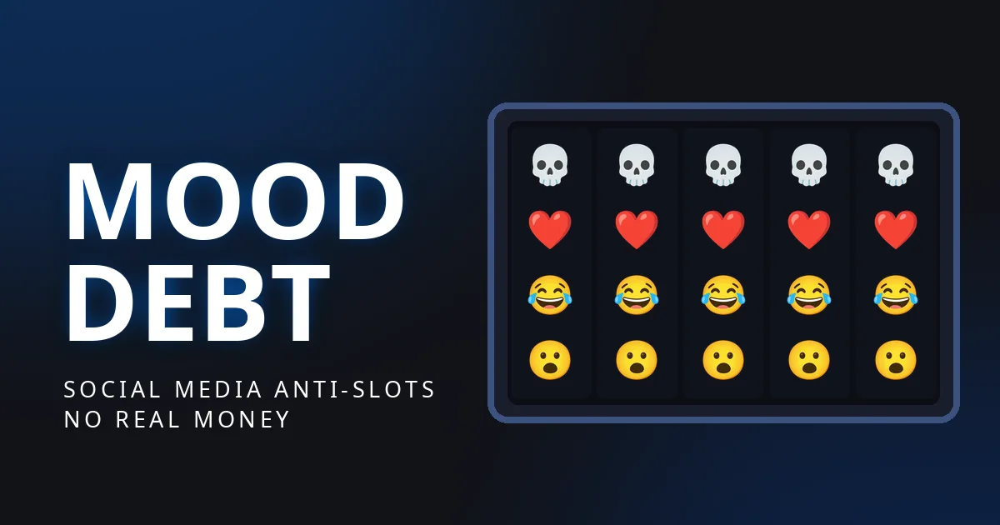
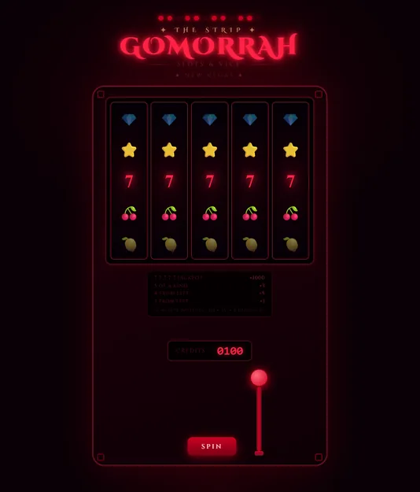
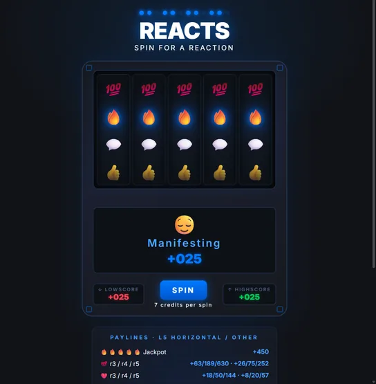

Play my social media anti-slots game MOODDEBT at [healeyj.com/mooddebt](https://healeyj.com/mooddebt)

[{: width="600" style="display:block;max-width:90%;height:auto;margin:30px 0;border:1px solid var(--borders-color)" }](https://healeyj.com/mooddebt)

## Devlog

### Fall 2023: Initial Vision

- Read and be influenced by Stolen Focus, Hooked, and Evil by Design
- Daydream about social media themed slot machine

### Winter 2024 / Winter 2025: Casino Satire Research

- Play and be influenced by Balatro, Luck be a Landlord, and CloverPit

### Spring 2026: Prototypes

- Build Gomorrah Slots prototype with Claude Projects and Artifacts

{: width="267" style="margin-left:0" }

- Develop "REACTS" anti-slot moodswing theme

{: width="272" style="margin-left:0" }

- Share "REACTS" prototype for initial feedback

### Summer 2026: Development Environment

- Switch from Claude Projects to Claude Code
- Move project to Github for version control and Kanban
- Experiment with CLAUDE.md system prompt for conversational development workflow

### Sept 28 - Oct 4 2026: Design Doc

* Write design document
* Tune payouts
    * Make 🔥 the jackpot
    * Make 💯 the runner-up

### Oct 5 - 11: Slow Rolls and Flavor Text

* Add more symbols
* Develop slow rolls and near misses
    * Reduce slow-roll frequency
    - Always play on near-miss finals
    * Play on some winning spins
    * Detect r3/r4/r5 patterns
    * Scale effects and tease messages
    * Highlight missed cell and glow flanking cells for emphasis
* Implement payline flavor text
    * Use "Everyone" for multiple paylines
    * Write distinct per-payline messages
    * Use true minus signs
* Tweak visual presentation
    * Switch to Noto Color Emoji
    * Speed up spin animation
    * Enlarge score above machine
    * Unify negative-credit colour
    * Re-fit machine after fonts load
* Fix bugs and improve QOL
    * Stop SPIN re-enabling early
    * Track true session high/low
    * Stop flashing result text
* Clean up code
    * Remove unreachable code paths
    * Define starting state once
    * Rename TARGET_IDX
    * Fix defects from design doc
* Add seeded RNG for spins

### Oct 12 - 18: Rebalance and Online Leaderboard

* Drop highscore for focus on lowscore
* Design barebones tutorial
* Rebalance pay table
    * Make all wins beat BET
    * Make all penalties clear BET
    * Make 👎 and 👻 rarer and harsher
    * Boost rare symbol payouts
* Research social media platform default reactions and change some symbols
* Rework mood ladder
    * Add more mood statuses
    * Rewrite flavor text
    * Scale win messages
* Fix bugs
    * Hide near-miss text when a greater payline hits
    * Remove meaningless slow rolls
* Polish slot machine artwork and effects
    * Make sparks fall correctly
    * Center emoji bubble effect
    * Always slow roll big hits
* Build spin simulation python script
    * Verify paytable changes
    * Inventory helper scripts
* Move spins server-side
    * Review costs before deploying
    * Add GitHub Actions deploy role
    * Add seeded test API stack
* Host game on GitHub Pages
    * Design CI/CD pipeline

### Oct 19 - 25: Secrets and Analytics

* Add Secrets
    * Add unlock animation
    * Show locked-secrets indicator
    * Tease Secrets in tutorial  
* Add share button
* Add reset button
* Polish presentation
    * Reserve space for flavor text
    * Restyle LOWSCORE indicator
    * Fix payline legend inconsistencies
    * Prevent scrolling during tutorial
    * Revise leaderboard update animation and player indicator
* Build online leaderboard with AWS
    * Generate anonymous themed handles
    * Track board views
    * Add starting seeds
* Improve operations
    * Set up read-only AWS CLI
    * Show "Server is busy" on rejection
    * Link test API in PR previews
    * Load fonts with game
* Plan analytics
    * Track anonymous spin results with timestamps 
    * Playtest and document time to reach lowscores
    * Mark data for autodeletion after 1 year
* Research itch.io game jams for submission

### Oct 26 - Nov 1: Tweaks and Game Jam Submissions

* Rename game to MOODDEBT
* Update leaderboard namegen
* Revise Secrets
    * Rewrite copy
    * Tune secret unlock mechanics
    * Add share prompts to later secrets
* Fix bug where lowscore updates before moodscore, spoiling result
* Open leaderboard from menu popup
* Flip positive jackpot to negative skull jackpot
* Improve workflow and infrastructure
    * Add Vite build for parallel feature development
    * Consolidate and prune API routes
    * Add Playwright headless testing
* Submit to itch.io game jams
    * Allow itch.io origin in CORS
    * Accept undesirable frame cropping on itch due to display ratio constraints

### Nov 2 - 8: Final Polish

* Research and add non-AI generated background music loop
    * Add Karl Casey's Creative Commons synthwave track "Miami Sky"
    * Add mute button
* Rework tutorial and fix bugs
    * Point popup at SECRETS button
    * Fix highlight misalignment
    * Move HOW TO PLAY to bottom row
    * Fix cramped mobile buttons and text
* Implement playtest feedback
    * Relabel mood display for clarity
    * Rework skull jackpot near-miss text
    * Restore paytable, open by default
